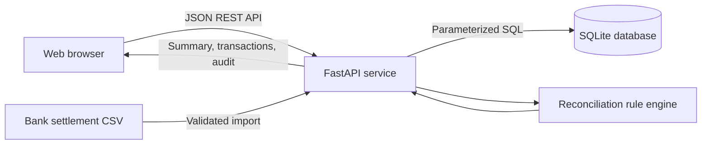

# ReconPilot

**A full-stack payment reconciliation and risk-operations dashboard built for a fintech engineering portfolio.**

ReconPilot simulates the workflow of a fintech operations team that compares payment processor transactions against bank settlement records. It identifies mismatches, flags missing settlements, helps analysts review exceptions, and tracks operational activity. **All data is synthetic.** It does not initiate transfers, connect to banks, or process real payments.


## Features

- **Automated settlement reconciliation:** matches gateway payments to bank settlement rows by reference, amount, and currency.
- **Exception classification:** reports missing settlements (48-hour SLA), amount mismatches, and currency mismatches.
- **Risk-based triage:** high/medium/low severity classification for operational review.
- **Analytics dashboard:** processed volume, reconciliation rate, exception exposure, 14-day trend visualization, and merchant-level breakdown.
- **Transaction explorer:** status filters, merchant/ID search, pagination, and detailed payment records.
- **Review workflow:** mark or reopen a record's analyst review status; changes write timestamped audit events.
- **Idempotent CSV imports:** repeat identical bank-settlement imports without duplicate rows; reject conflicting data and unknown payment IDs.
- **CSV export:** download reconciliation results, with protections against spreadsheet formula injection.
- **Responsive frontend:** desktop/mobile interface built with semantic HTML, CSS, and JavaScript; no frontend build step required.
- **Tests and automation:** pytest coverage and GitHub Actions CI, plus Docker and Docker Compose.

## Tech stack

| Layer | Technology |
| --- | --- |
| API | Python, FastAPI, Pydantic |
| Storage | SQLite, relational schema, indexes, parameterized SQL |
| UI | JavaScript, HTML5, CSS3, SVG |
| Testing | pytest, FastAPI TestClient, HTTPX |
| Infrastructure | Docker, Docker Compose, GitHub Actions |

## Quick start

Requires **Python 3.10+**.

```bash
git clone https://github.com/YOUR_USERNAME/reconpilot.git
cd reconpilot
python -m venv .venv
source .venv/bin/activate   # Windows PowerShell: .venv\Scripts\Activate.ps1
pip install -r requirements.txt
python -m app
```

Open **http://127.0.0.1:8000** for the dashboard or **http://127.0.0.1:8000/docs** for the interactive OpenAPI reference.

Alternatively, run `docker compose up --build` and open the same URL. The Docker Compose configuration persists the demo SQLite database in a named volume.

On first run, ReconPilot automatically creates the schema and generates **420 synthetic payments** and matching/mismatching/missing bank settlements. Refreshes do not regenerate or overwrite the data. SQLite storage defaults to `/tmp/reconpilot/reconpilot.db`. To choose a custom path:

```bash
RECONPILOT_DB=./data/reconpilot.db python -m app
```

For a clean demo, stop the server and delete its demo `.db` file (or remove its Docker named volume). **Never do this with real data.**

## Reconciliation algorithm

1. A payment is captured, pending, or failed. Failed and pending payments do not count as matched transactions.
2. For captured payments, look for the settlement with the same `gateway_reference`.
3. If no settlement exists and the captured payment is older than 48 hours, flag `missing_settlement`; younger captures remain `pending`.
4. When a settlement exists, compare currencies first, then amounts in **integer cents** (no floating-point currency comparisons).
5. On exact match, mark the record `matched`. Otherwise flag `currency_mismatch` or `amount_mismatch`.
6. Risk is prioritized using transparent rule-based checks (currency mismatches, a sizable dollar discrepancy, or a large exposed payment). These are **operational alerts**, not fraud predictions.
7. Analysts can acknowledge review without changing the underlying payment or settlement record.

The displayed reconciliation rate is the proportion of `matched` payments among captured payments eligible for reconciliation (excluding recent captured-but-not-yet-due payments). The `open exceptions` metric excludes reviewed cases, while the match-rate denominator does not: marking a case reviewed **does not fabricate a match**.

## Example: resolve a missing settlement

With the API running, execute:

```bash
python scripts/reconcile_example.py
```

The helper selects a synthetic payment currently missing a settlement, builds a valid CSV, imports it, and prints its reconciliation status before and after. You can also import your own CSV through the dashboard's **Import settlement** button.

CSV format (header names are required):

```csv
gateway_reference,amount,currency,settlement_date,bank_reference
PAY-EXAMPLE-REFERENCE,85.25,USD,2026-10-28,BANK-REF-0001
```

Replace `PAY-EXAMPLE-REFERENCE` with a valid payment ID returned by `/api/transactions`; the shown example is **illustrative**, not guaranteed to exist in the seeded data.

Imports accept up to 200 records / 100 KB. The import validates the whole file before writes, rejects unknown payment IDs and conflicting settlements, and skips duplicates when existing settlement values are identical.

## REST API

| Method | Endpoint | Description |
| --- | --- | --- |
| GET | `/api/health` | Service / data-mode health |
| GET | `/api/summary` | KPIs, 14-day trend, status distribution, merchants |
| GET | `/api/transactions` | Search, filter, paginate payment records |
| GET | `/api/transactions/{id}` | Single payment and settlement detail |
| POST | `/api/transactions/{id}/review` | Toggle review state (`{"reviewed":true}`) |
| GET | `/api/audit` | Timestamped review/import actions |
| POST | `/api/settlements/import` | Upload a raw `text/csv` request body |
| GET | `/api/export/transactions.csv` | Download reconciliation export |
| GET | `/docs` | FastAPI Swagger UI |

## Tests

```bash
pip install -r requirements-dev.txt
python -m pytest -q
node --check app/static/app.js  # optional JavaScript syntax check
```

The suite checks seeding, reconciliation metrics, filtering, pagination, idempotent reviews, audit events, import validation, duplicate/conflict handling, CSV export, and static page delivery.

## Architecture



The backend is divided into `app/core.py` (schema, deterministic seed, reconciliation engine, aggregation) and `app/api.py` (request validation, endpoints, exports, review workflow). The frontend is served by the same origin to keep local development simple.

**Engineering considerations:** integer minor units prevent common floating-point rounding errors; settlement reference uniqueness supports idempotency; input validation and parameterized queries protect the demo from malformed rows and SQL injection; audit events keep a record of review changes. To support large production data sets, move the matching and aggregation from Python list processing to indexed database queries or batch jobs, and move storage to PostgreSQL.

## Portfolio / interview talking points

- **Problem:** payment processors and bank settlement records can disagree, leaving operations teams with difficult-to-trace exceptions.
- **Solution:** created a rules-based reconciliation service and dashboard showing matching outcomes, exception exposure, merchant volume, and a review queue.
- **Technical choices:** FastAPI for typed HTTP contracts, SQLite for an easily runnable demo, integer cents for safe amount comparison, and a no-build responsive UI.
- **Reliability:** built idempotent import semantics, all-or-nothing CSV validation, an operational audit trail, Docker packaging, CI, and automated tests.
- **Next production step:** role-based authentication, immutable event storage, database migrations, PostgreSQL, queues/background processing, fraud data governance, monitoring, and integration testing.

## Project structure

```text
reconpilot/
├── app/
│   ├── __main__.py
│   ├── api.py                  # FastAPI endpoints, validation, import/export
│   ├── core.py                 # Schema, synthetic seed, matching engine
│   └── static/
│       ├── index.html         # Responsive dashboard
│       ├── styles.css
│       └── app.js
├── docs/                       # Screenshots
├── scripts/reconcile_example.py
├── tests/test_api.py
├── .github/workflows/ci.yml
├── Dockerfile
├── compose.yaml
├── requirements.txt
├── requirements-dev.txt
└── SECURITY.md
```

## Safety and scope

This is a **portfolio demo, not a payment processor or production financial system**. The API has no authentication, the rule engine is not a fraud model, and its example audit table is not tamper-proof. Do not expose this server publicly as-is or use real account credentials, bank records, or personally identifiable information. See [SECURITY.md](SECURITY.md) for deployment limitations.

## License

MIT License. See [LICENSE](LICENSE).
